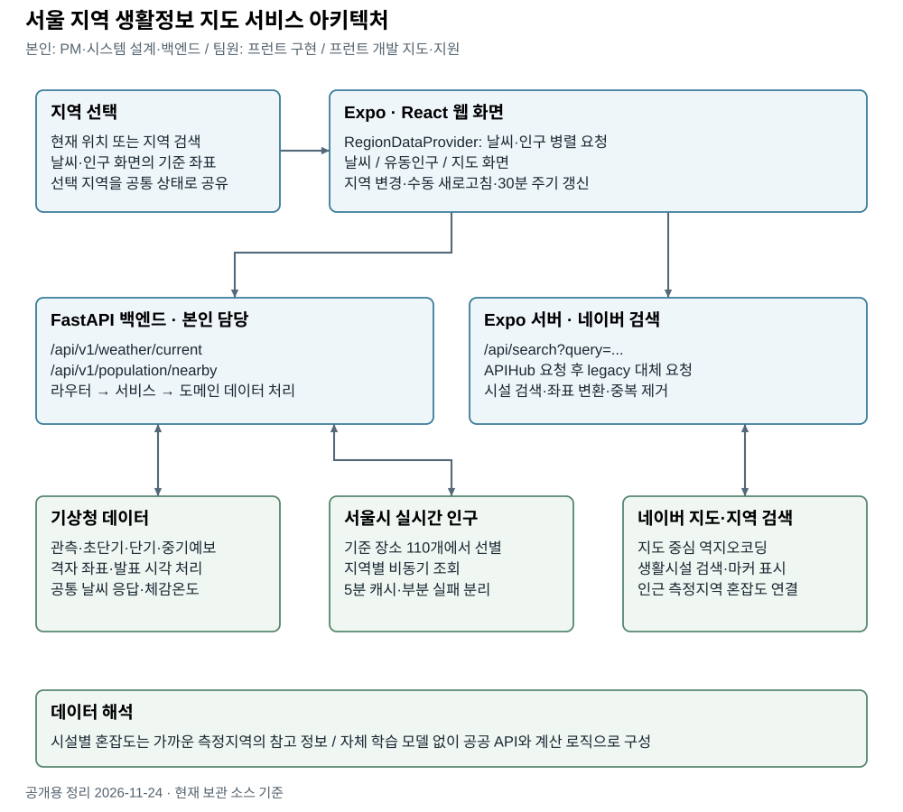
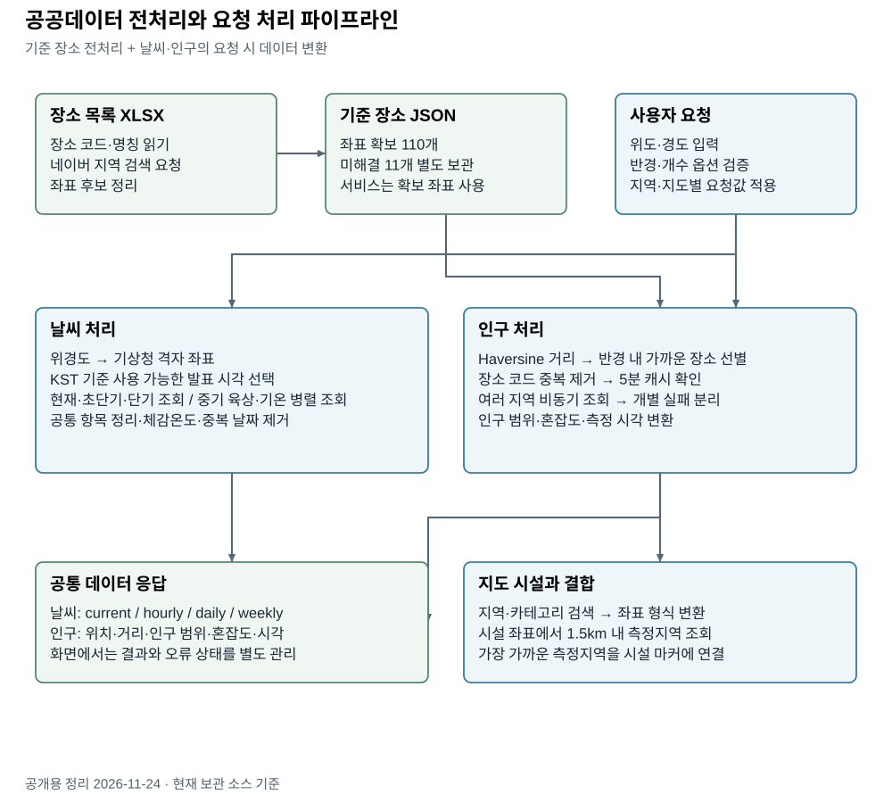

# 서울 지역 생활정보 지도

현재 위치나 검색한 지역의 날씨·유동인구·주변 생활시설을 함께 확인하는 지도 기반 서비스입니다. 기상청·서울시·네이버의 데이터를 연결하고 화면에서 사용할 형태로 가공했습니다.

저는 **PM으로 시스템 설계·핵심 기능 제안·일정 조율을 담당하고, 백엔드를 구현했습니다.** 후배 팀원들과 협업하며 **프런트엔드 개발 방향과 백엔드 연계에 대한 지도·지원**도 맡았습니다. 프런트 화면 구현은 팀원의 기여로 구분합니다.

[프로젝트 소개 PDF · 1쪽](docs/project_overview.pdf) · [상세 기여](docs/contribution_scope.md) · [설치와 실행](docs/setup.md)

## 서비스 기능

| 기능 | 구현 내용 |
|---|---|
| 지역 선택 | 현재 위치 조회, 지역 검색, 선택 지역을 날씨·인구 화면에서 공유 |
| 날씨 | 현재 관측·초단기·단기·중기예보 통합, 체감온도 계산 |
| 유동인구 | 반경 내 서울시 측정지역의 인구 범위·혼잡도·거리·측정 시각 조회 |
| 생활시설 지도 | 주민센터·운동시설·공원·지하철 등의 검색 결과와 마커 표시 |
| 장소 상세 | 시설 좌표를 기준으로 가장 가까운 인근 측정지역의 혼잡도 연결 |
| 공공서비스 연결 | 정부24 외부 페이지 연결 |

## 본인 기여

| 영역 | 담당 범위 |
|---|---|
| PM | 프로젝트 일정 조율, 핵심 기능 제안 |
| 시스템 설계 | 서비스 구성과 데이터 흐름 설계 |
| 백엔드 | FastAPI, 외부 API 연동, 좌표·시간·응답 데이터 변환, 조회 API |
| 팀 개발 지도 | 후배 팀원의 프런트 개발 방향과 데이터 연계에 대한 지도·지원 |

## 주요 백엔드 구현

- **날씨 데이터 통합:** 위경도를 기상청 격자 좌표로 변환하고 발표 시각에 맞는 데이터를 요청합니다. 관측·예보를 현재·시간별·일별·중기 데이터로 정리하고 체감온도를 계산합니다.
- **공간 기반 인구 조회:** 측정지역 좌표와 요청 위치 사이의 Haversine 거리를 계산해 반경 내 장소를 거리순으로 선별합니다. 저장된 기준 좌표는 110개이며, 인구 수치와 혼잡도는 외부 API에서 조회합니다.
- **비동기 처리와 캐시:** 여러 측정지역을 병렬 조회하고 일부 요청이 실패해도 성공 결과를 반환합니다. 동일 지역 응답은 5분간 프로세스 메모리에 캐시합니다.
- **명시적인 응답 구조:** 데이터 모델에 좌표·측정 시각·인구 범위·혼잡도를 담고, 유효하지 않은 입력과 외부 데이터 오류를 구분해 처리합니다.

## 서비스 아키텍처

## 데이터 처리 파이프라인

자체 모델 학습이 중심인 프로젝트가 아니라 공공데이터를 가공해 서비스에 연결한 프로젝트입니다. 학습 파이프라인 대신 기준 장소 전처리와 요청 시 데이터 처리 흐름을 정리했습니다.

[아키텍처 상세](docs/architecture.md) · [데이터 처리 상세](docs/data_pipeline.md) · [API 명세](docs/api_reference.md)

## 코드 읽는 순서

1. [API 진입점](back-end/main.py)과 [라우터 구성](back-end/routers/api_router.py)
2. [날씨 서비스](back-end/services/weather_service.py) → [기상청 로더](back-end/domain/weather/loader.py) → [응답 변환](back-end/domain/weather/transformer.py)
3. [인구 서비스](back-end/services/population_service.py) → [주변 장소 선별](back-end/domain/population/calculator.py) → [실시간 조회와 캐시](back-end/domain/population/realtime_loader.py)
4. [기준 장소 전처리](back-end/scripts/build_seoul_realtime_landmarker.py)
5. [팀 프런트의 지역 상태 공유](front-end/src/providers/RegionDataProvider.tsx), [검색 API](front-end/src/app/api/search+api.ts), [지도 화면](front-end/src/features/map/components/MapDashboard.tsx)

## 기술 구성

- 백엔드: Python, FastAPI, httpx, dataclass, Pydantic Settings
- 프런트엔드: Expo 54, React 19, TypeScript, Expo Router, React Native Web
- 외부 데이터: 기상청 APIHub, 서울시 실시간 인구 API, 네이버 지도·지역 검색

프런트는 Expo 기반이며 현재 지도 코드는 브라우저 DOM과 네이버 JavaScript 지도를 사용하는 웹 중심 구성입니다. 프런트 소스는 팀 서비스의 통합 흐름을 보여주기 위해 함께 보관했습니다.

## 개발 기록과 공개 범위

Git 기록상 최초 커밋은 **2026년 8월 11일**, 최종 커밋은 **2026년 8월 20일**입니다. 주요 백엔드 커밋은 8월 17일부터 확인됩니다. 원본 기록과 공개 사본 생성일은 구분하며, 이 저장소의 정리일은 2026년 11월 24일입니다.

[개발 이력](docs/development_history.md) · [원본 파일 생성·수정 시각](docs/source_file_index.csv) · [구현 범위](docs/implementation_scope.md)

인증 정보·가상환경·의존성 설치 폴더·바이트코드·기존 Git 이력·배포 압축 파일은 제외했습니다. 실행에 필요한 환경변수는 `.env.example`에 정리했습니다. 기존 프런트의 라이선스 파일은 원문을 유지했습니다.
