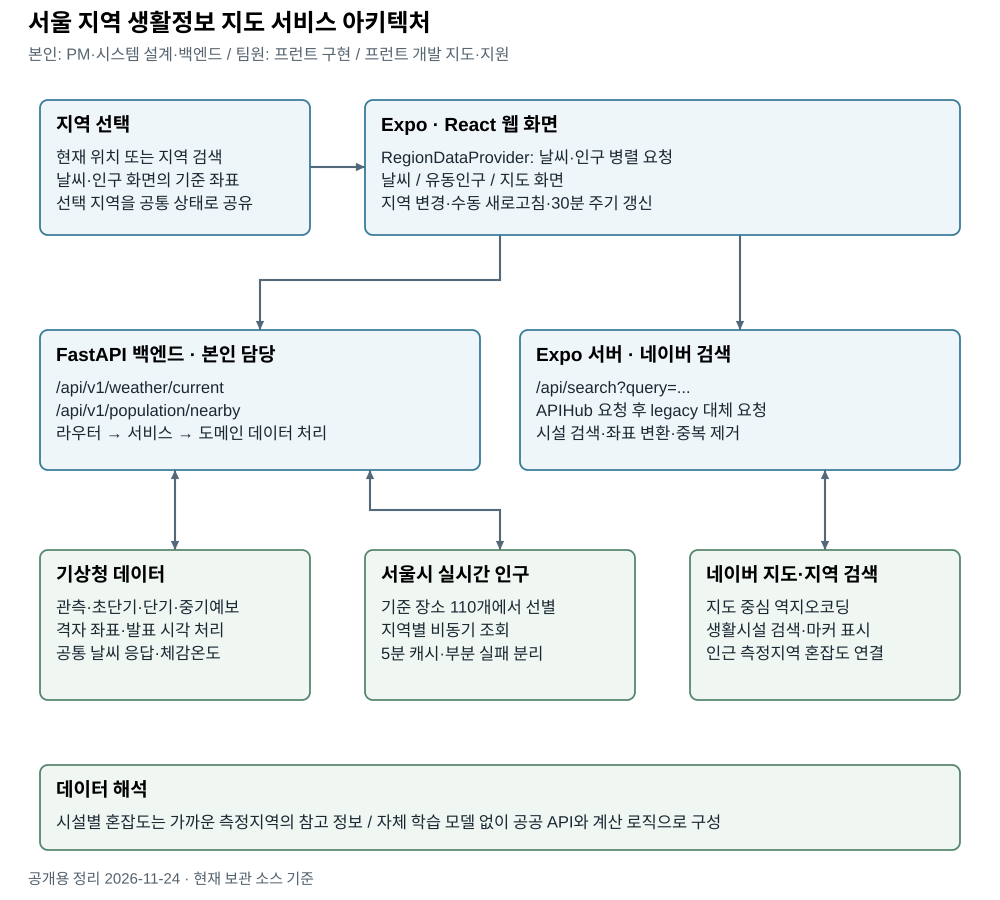

# 서비스 아키텍처

## 구성 요소

사용자가 현재 위치 또는 지역을 선택하면 Expo·React 화면이 해당 좌표를 공통 지역 상태로 보관합니다. 날씨·인구 조회는 FastAPI로, 시설·지역 검색은 Expo 서버 API를 통해 네이버로 전달됩니다.

| 계층 | 구현 위치 | 역할 |
|---|---|---|
| 화면·상태 | front-end/src/app, providers/RegionDataProvider.tsx | 지역 선택·날씨·인구 상태 공유 |
| 지도·시설 | front-end/src/features/map | 지도 중심 검색·시설 마커·장소 상세 |
| 네이버 검색 서버 | front-end/src/app/api/search+api.ts | APIHub 지역 검색 및 legacy API 대체 요청 |
| HTTP 라우터 | back-end/routers | 입력 검증·오류 응답·서비스 호출 |
| 서비스 | back-end/services | 지역별 날씨·인구 처리 흐름 조합 |
| 도메인 처리 | back-end/domain | 데이터 로드·공간 계산·변환·응답 모델 |
| 기준 데이터 | back-end/data | 측정지역 코드·명칭·좌표 |

## 날씨 연결

`weather_service.get_weather`는 위경도를 기상청 격자 좌표로 변환합니다. 실황·초단기·단기예보를 조회한 뒤 현재 관측, 시간별 예보와 일별 요약을 구성합니다. 중기 육상예보·기온예보를 함께 조회해 중기 항목을 만들고 단기 날짜와 중복되는 항목을 제외합니다.

## 인구 연결

`population_service.get_nearby_population`은 로컬 기준 장소를 읽고 반경 내 측정지역을 거리순으로 선별합니다. 해당 지역을 병렬 조회하고 인구 범위·혼잡도·측정 시각을 공통 모델로 변환합니다. 인구 응답 캐시는 프로세스 내 메모리이며 별도 DB나 Redis는 사용하지 않습니다.

## 프런트 연결

`RegionDataProvider`는 날씨·인구를 `Promise.allSettled`로 요청해 각 요청의 성공·실패를 별도로 보관합니다. 지역 변경, 수동 새로고침, 30분 주기로 이 공통 데이터를 갱신합니다. 지도 시설 마커는 별도 훅에서 시설별 인근 인구를 조회하고 컴포넌트 생존 기간 동안 캐시합니다. 이 지도용 캐시는 서버의 5분 캐시와 구분합니다.

지도 이동이 멈추면 중심 좌표를 바탕으로 행정구역명을 역지오코딩하고 카테고리 키워드로 지역 검색을 요청합니다. 시설 선택 시 좌표와 가까운 서울시 측정지역을 연결해 상세 패널에 표시합니다.

## 소프트웨어 실행 구성

Expo 웹 서버는 화면과 `/api/search`를 제공하고 FastAPI 서버는 `/api/v1/weather/current`, `/api/v1/population/nearby`, `/health`를 제공합니다. 이 그림은 보관 소스의 소프트웨어 구성이며 특정 클라우드·도메인에서 실제 운영 중인 배포 구성을 가정하지 않습니다.
