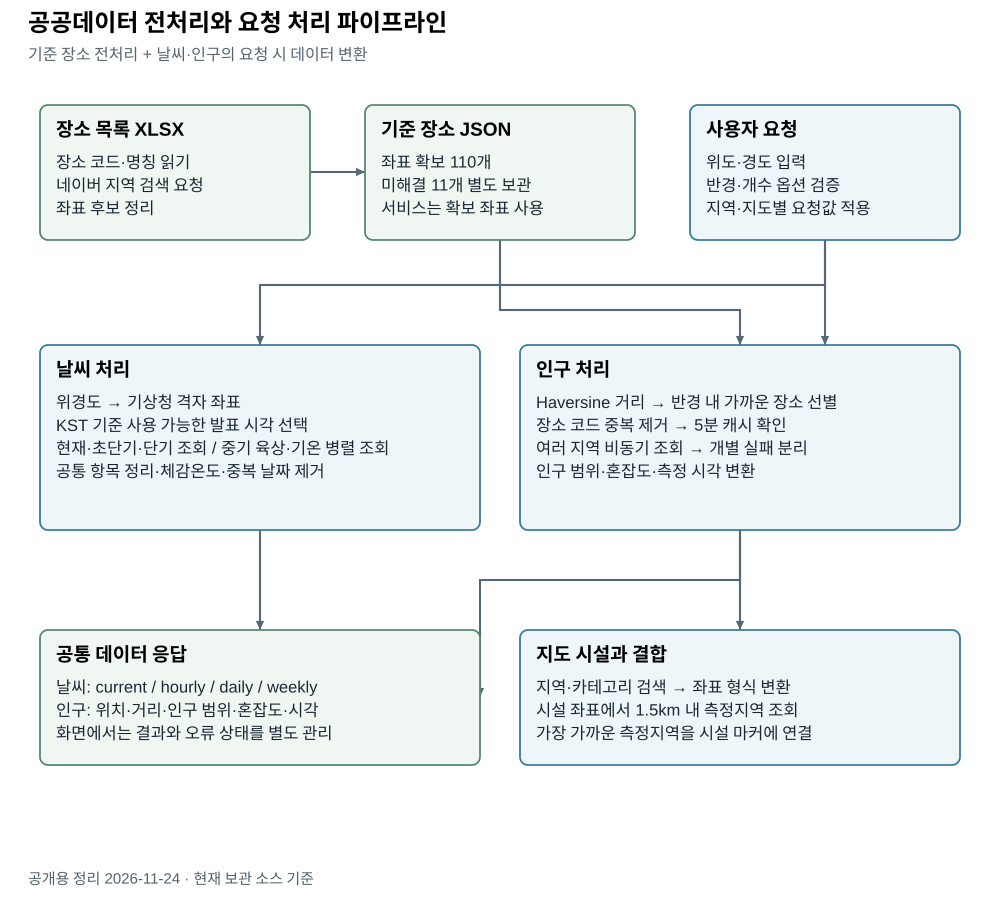

# 공공데이터 전처리와 실시간 조회 파이프라인

학습 모델 대신 기준 장소를 만드는 전처리와 요청 시 데이터 처리로 구성됩니다.

## 기준 장소 전처리

1. `back-end/data/raw/seoul_realtime_areas.xlsx`에서 장소 코드·명칭을 읽습니다.
2. `scripts/build_seoul_realtime_landmarker.py`가 네이버 지역 검색으로 장소 후보를 조회합니다.
3. 후보 좌표를 위경도로 정리해 장소 코드·명칭과 결합합니다.
4. 좌표를 확보한 결과는 `seoul_realtime_landmarks.json`, 확인이 필요한 항목은 `seoul_realtime_landmarks_unresolved.json`으로 저장합니다.

보관 결과는 좌표 확보 110개, 미해결 11개입니다. 이는 기준 장소 전처리 상태이며 인구 예측 정확도나 API 실시간 가용률을 뜻하지 않습니다. JSON은 고정 좌표 목록이고 인구 수치는 요청 시 조회합니다.

## 날씨 요청 처리

위도·경도 → 기상청 격자 좌표 → KST 기준 발표 시각 선택 → 현재 관측·초단기·단기예보 요청 → 카테고리별 수치와 예보 시각 정리 → 현재·시간별·일별 응답으로 변환합니다.

이어서 좌표에 맞는 중기예보 권역을 선택하고 육상예보·기온예보를 병렬 요청합니다. 중기 항목을 정규화한 뒤 단기 데이터와 날짜가 겹치지 않도록 합칩니다. 중기 원본은 발표일 기준 3~10일 뒤 항목을 사용합니다.

체감온도는 기온이 27도 이상이고 습도가 있을 때 Heat Index를, 기온이 10도 이하이고 풍속이 시속 4.8km를 넘을 때 Wind Chill을 적용합니다. 나머지 조건에서는 기온을 사용합니다. 학습 모델의 예측값이 아니라 계산식에 따른 값입니다.

## 인구 요청 처리

좌표·반경·개수 검증 → 기준 장소 JSON 로드 → Haversine 거리 계산 → 반경 내 장소 거리순 선별 → 장소 코드 중복 제거 → 5분 캐시 확인 → 미캐시 지역 비동기 조회 → 개별 실패 분리 → 공통 응답 변환 순서입니다.

변환 결과에는 장소 코드·명칭·좌표·거리, 최소·최대 인구, 혼잡도, 측정 시각이 포함됩니다. 일부 조회가 실패하면 성공한 장소를 반환하고 전부 실패하면 외부 데이터 오류로 처리합니다.

## 지도 시설과 혼잡도 결합

지도 중심의 행정구역명을 역지오코딩하고 카테고리별 최대 3개 키워드를 검색합니다. API별 검색 결과의 좌표 형식을 변환하고 HTML 강조 태그와 중복을 정리합니다. 각 시설 좌표에서 1.5km 내 측정지역을 조회해 가장 가까운 지역 정보를 연결합니다.

시설 이용자 수를 직접 센 결과나 공간 보간으로 산출한 시설 단위 인구 추정치가 아니라, 인근 측정지역의 참고 정보입니다.
